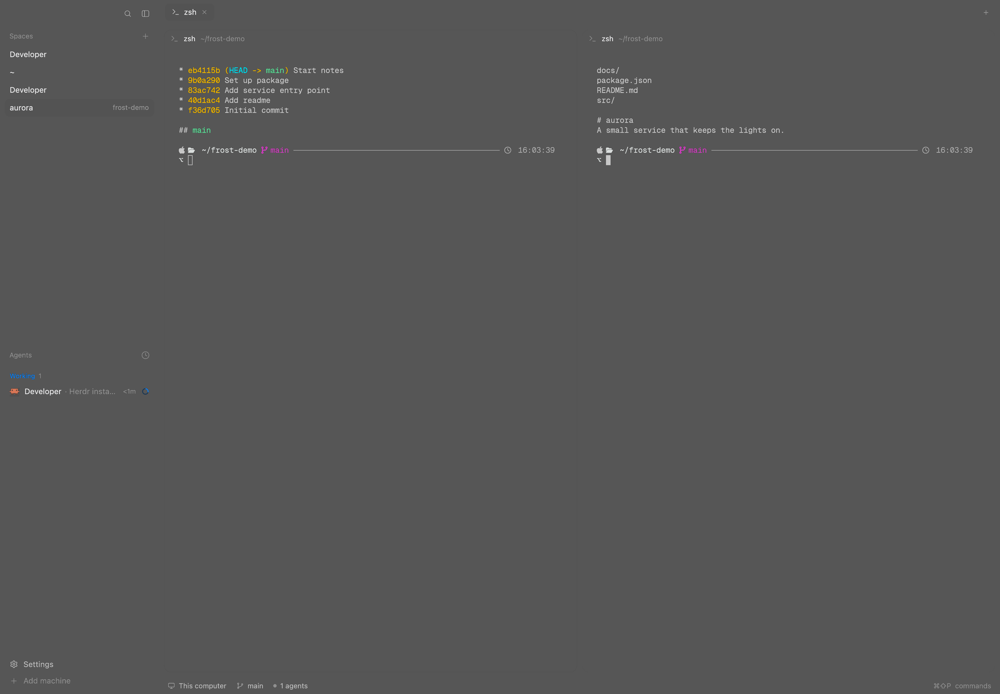

# Minimal Frost

A quiet, frosted layout for [Herdr](https://herdr.dev). One grey glass tint across the whole window, no dividing lines, clear terminals over the blurred desktop, softly rounded panes and popups, Figtree and Geist Mono, and a Ghostty-derived terminal palette.



## Install

Copy into your Herdr home (`~/.config/herdr-app`), renaming anything whose name you already use:

- `layouts/minimal-frost.json` and `layouts/minimal-frost.png` → `layouts/`
- `themes/minimal-frost.json` → `themes/`
- `mods/frost-*` → `mods/`
- merge `keys.json` into your own `keys.json` (adds ⌘P / Super+P and Ctrl+Shift+K → rounded picker, for this layout only)

Then:

```sh
for m in ~/.config/herdr-app/mods/frost-*; do herdr-app check "$m"; done
herdr-app do layout.switch '{"name":"minimal-frost"}'
```

`ctrl-shift-l` switches back to your previous layout.

## Notes

- Works on macOS, Windows and Linux. The glass needs window blur (macOS, Windows, some Wayland compositors); without it the tint looks flat.
- Figtree (the UI font) is bundled in `mods/frost-sidebar/fonts/` as static Regular, Medium, SemiBold and Bold files, so nothing needs installing. Restart Herdr once after installing so it loads them.
- The terminal font size follows your own Settings; the layout doesn't set it.
- The `frost-spaces`, `frost-menu` and `frost-picker` mods run `git` and `hc` locally, the same as the Herdr mods they're copied from. No network access.
- [RECIPE.md](RECIPE.md) describes the layout in full, for rebuilding it from scratch.

## License

The mods are modified copies of Herdr's own mods and are distributed under the Apache License 2.0 (see [LICENSE](LICENSE) and [NOTICE](NOTICE)). The bundled Figtree font is © The Figtree Project Authors under the SIL Open Font License 1.1 ([OFL.txt](mods/frost-sidebar/fonts/OFL.txt)).
