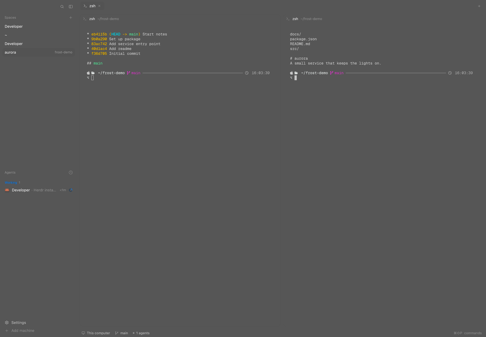

# Minimal Frost

A quiet, frosted take on Herdr's default layout. The whole window is one sheet of tinted glass over the blurred desktop: sidebar, tab bar, content area and status bar share a single grey tint with no dividing lines, and terminals have no background of their own, so text sits directly on the glass. Panes are softly rounded cards outlined by a hairline. Colour is reserved for terminal output and agent status.



## What you see

Left to right, top to bottom:

- **Sidebar** (268 px wide, tint `#313233b3`):
  - **Top row** (46 px): traffic lights, then search and sidebar-toggle buttons on the right. No app logo or name.
  - **Spaces**: space names only, with no coloured letter tiles, plus their git branch and changes.
  - **Agents**: Herdr's agent list without program icons. Its "Sort agents" popup has 12 px rounded corners.
  - **Footer** (69 px): Settings and Add machine.
- **Tab bar** (42 px, same tint): tabs with no fill. The active tab has a faint fill (`selected`, `#ffffff1f`) and full-white text, and inactive tabs use 70% white text. **+** is on the right.
- **Content area** (same tint, 8 px padding):
  - Terminal panes are cards with a 12 px radius, an 8 px gap and a clear background.
  - Borders are a 1 px hairline: `#ffffff14` (8% white), and `#ffffff40` (25% white) on the focused pane.
  - Each pane has a 30 px title row with no background: program icon, title, folder and status.
  - Terminal text has 24 px padding on every side.
- **Status bar** (28 px, same tint): machine, branch, agent count and the palette hint.

Type:

- **Terminals:** Geist Mono, 13 px, weight 400 (Regular)
- **Interface:** SF Pro Text

Colours:

- **Terminal theme** (`themes/minimal-frost.json`):
  - Background `#222222`, foreground `#c7c7c7`, selection `#485e77`
  - ANSI: red `#d04e61`, green `#5bdc96`, yellow `#ecb400`, blue `#7443f8`, magenta `#d341c2`, cyan `#00e0f2`, plus their bright versions
- **Interface colours** (layout `colors`):
  - Labels: secondary 70% white, dim 50% white
  - Accent: neutral `#d4d4d4`
  - Working: macOS system blue `#0a84ff`
  - Menus and dialogs: `#1a1a1acc`
  - Window base tint: `#1a1a1a33`
  - All borders transparent

## How it behaves

- **Agent status:**
  - **working:** a blue (`#0a84ff`) spinner on the tab, pane title and agent row
  - **blocked:** the theme's needs-you colour and a "Needs you" badge on the pane
  - **done:** a dot
  - **idle:** no mark
- **Glass:** with `window_blur`, macOS blurs the desktop behind every surface. Everything is tinted by the same `#313233b3`, so the window reads as one surface.
- **Menus and dialogs** use 80% of the sidebar's colour. Herdr can't blur its own content, so a lighter tint would let terminal text show through.
- **Rounded popups:**
  - **12 px corners:** right-click menus (terminal, tab, space), the **+** menu, the Go to… picker (⌘P and the sidebar search button) and the Sort agents popup
  - **Still square:** the command palette (⌘⇧P), which is Herdr's own screen and can't be modified
- **Hover:** tabs, rows and buttons show a 4% white highlight (`#ffffff0a`).
- **Unchanged from Herdr:** pane dragging, splits, zoom, the Files/Changes panel, sidebar resizing and collapsing.

## Built from

- **Layout `layouts/minimal-frost.json`:** a clone of Herdr's `main` (version 0.1.16). Its node tree:
  ```
  root row (titlebar none, traffic_lights [12,16], window_blur, theme minimal-frost)
  ├─ sidebar column 268px, background #313233b3
  │  ├─ brand block 46px, window_drag ……… frost-sidebar
  │  ├─ sidebar-lists column
  │  │  ├─ spaces block ………………………… frost-spaces
  │  │  └─ agents block ………………………… frost-agents
  │  └─ sidebar-footer block 69px ………… workspace-chrome {footer: true}   (shipped)
  └─ work column
     ├─ tabs block 42px, window_drag, #313233b3 … frost-tab-bar
     ├─ work-body row, padding 8, #313233b3
     │  ├─ main block: tab active, pane frame (header frost-pane-header, radius 12, gap 8)
     │  └─ panel column (hidden): files / changes stack   (shipped)
     └─ status block 28px, #313233b3 ……… workspace-status   (shipped)
  ```
  Root settings:
  - `ui_font` SF Pro Text, `font` Geist Mono, `font_size` 13, `font_weight` 400
  - `terminal_padding` [24, 24], `terminal_opacity` 0
  - `terminal_menu` frost-menu
  - `colors` as listed under What you see
- **Mods:** each is a copy of one of Herdr's own mods, renamed and changed as below.

  | Mod | Copied from | Change |
  |---|---|---|
  | `frost-sidebar` | `workspace-chrome` | logo and "Herdr" title removed; search opens `frost-picker` |
  | `frost-spaces` | `spaces` | coloured letter tile removed from rows (kept on the collapsed rail); space menu opens `frost-menu` |
  | `frost-agents` | `agents` | no program icons on agent rows; Sort agents popup gets `.rounded(12)` |
  | `frost-tab-bar` | `tabs` | active tab fill `selected` (was `raised`); tab menu opens `frost-menu`, + opens `frost-new-menu` |
  | `frost-pane-header` | `pane` | no background |
  | `frost-menu` | `menu` | `.rounded(12)` |
  | `frost-new-menu` | `new-menu` | `.rounded(12)` |
  | `frost-picker` | `picker` | `.rounded(12)`; no letter tiles on space headings; tabs listed by the same name the tab bar shows (an agent's live title) rather than their number |

- **Shipped mods used as they are:** `workspace-chrome` (footer), `workspace-status`, `files` and `changes`, plus icons from `mods/workspace-chrome/` and `mods/pane/`.
- **Herdr functions and commands:** the copied mods call the same ones as the originals: `run`, `openOverlay`, `spaces()`, `agents()`, `panes()`, `layout()`, and `mod.open`.
- **Programs run** (all inherited from Herdr's originals):
  - `frost-spaces` runs `git` in each space's folder, calls `hc` and watches the folder.
  - `frost-menu` runs `git` for worktree items.
  - `frost-picker` calls `hc`.
- **Network:** none.
- **`keys.json`:** `layout:minimal-frost` → `cmd-p` opens `frost-picker`.

## Watch out

- **Sub-agents:** in Herdr's agents list, the program icon is also the button that folds an agent's sub-agents. Without icons, sub-agents always show unfolded.
- **The tint only reads as glass with blur.** On a platform without window blur, `#313233b3` sits over nothing and looks flat. Raise the tint's alpha there.
- **Window base:** the theme's `background` is painted under the whole window. It has to be translucent (`#1a1a1a33`) for anything to be see-through. Setting only `canvas`/`chrome` transparent does nothing.
- **Terminal background:** terminals draw their background from that same colour. A fully clear `background` (`#00000000`) makes terminals black, so keep some alpha.
- **Removing lines:** making `border` transparent removes the section lines. It also removes outlines from menus, dialogs and the Files/Changes panel.
- **Pane borders** are set explicitly on the pane frame, so they stay visible.
- **Dialogs and the palette** can't be frosted. Herdr has no blur for its own content, so they stay at 80% to avoid text bleeding through.
- **SF Pro Text is macOS-only.** Elsewhere the interface falls back to Herdr's default font.
- **Your keys.json:** merging this `keys.json` into your own stops Herdr from adding new default shortcuts to that file on updates.
- **Screenshots:** `herdr-app shot` doesn't capture the desktop behind the window. `preview.png` shows the transparent areas flattened to grey.

## Done when

- `herdr-app check mods/<name>` passes for all eight `frost-*` mods.
- `herdr-app do layout.switch '{"name":"minimal-frost"}'` applies with `herdr-app status` showing `"errors": []`.
- No lines separate the sidebar, tab bar, content and status bar.
- Desktop shows blurred through all four of them, in the same grey tint.
- Terminals show the blurred desktop behind their text, and their text uses the Minimal Frost palette in Geist Mono 13.
- The active tab has a faint fill, and other tabs have none.
- Space rows show names without letter tiles.
- Pane title rows have no background.
- Right-clicking a terminal, tab or space opens a menu with rounded corners, and so do **+**, ⌘P and Sort agents.
- An agent at work shows a blue spinner.
